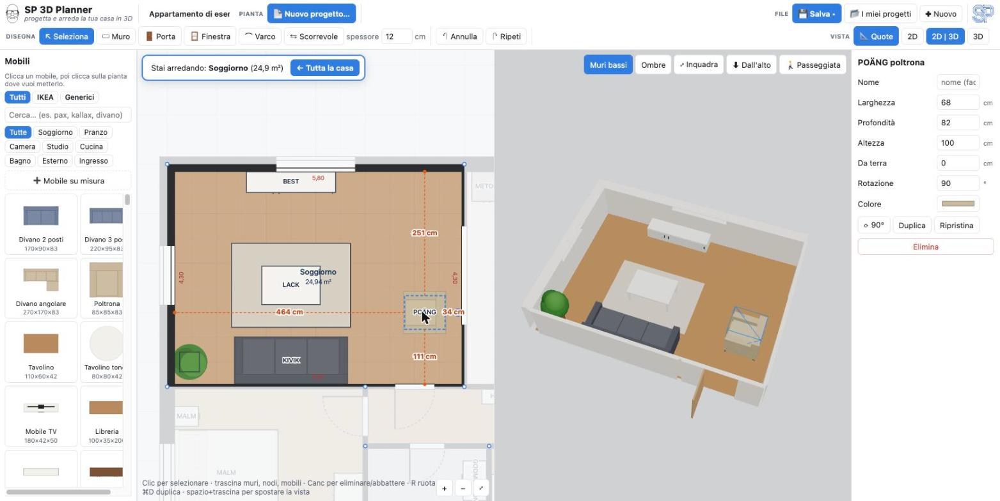

<p align="center"></p>

# SP 3D Planner

**Progetta e arreda la tua casa in 3D partendo dalla pianta.** Carichi la pianta del tuo appartamento (anche quella catastale), la fai leggere a Claude e in un minuto hai muri, porte e finestre in 2D e in 3D. Poi sposti o abbatti i muri, scegli i mobili (anche IKEA) e ci cammini dentro.

Funziona tutto nel browser: **niente da installare, niente account, niente server**. I tuoi progetti restano sul tuo computer.

### 👉 [Apri SP 3D Planner](https://procolo75.github.io/sp-3d-planner/)


---

## Indice

- [Cosa puoi fare](#cosa-puoi-fare)
- [Primi passi](#primi-passi)
- [1. Creare il progetto dalla pianta](#1-creare-il-progetto-dalla-pianta)
- [2. Muoversi nella pianta 2D](#2-muoversi-nella-pianta-2d)
- [3. Muri](#3-muri)
- [4. Stanze](#4-stanze)
- [5. Porte, finestre, varchi e ante scorrevoli](#5-porte-finestre-varchi-e-ante-scorrevoli)
- [6. Mobili](#6-mobili)
- [7. Arredare una stanza alla volta](#7-arredare-una-stanza-alla-volta)
- [8. La vista 3D](#8-la-vista-3d)
- [9. La passeggiata](#9-la-passeggiata)
- [10. Salvare e aprire i progetti](#10-salvare-e-aprire-i-progetti)
- [11. Telecamere e copertura](#11-telecamere-e-copertura)
- [Scorciatoie da tastiera](#scorciatoie-da-tastiera)
- [Domande frequenti](#domande-frequenti)
- [Privacy](#privacy)
- [Formato della mappa](#formato-della-mappa)
- [Per sviluppatori](#per-sviluppatori)
- [Licenza](#licenza)

---

## Cosa puoi fare

- **Dalla pianta al 3D**: Claude legge la pianta (PDF o foto, anche con le quote) e prepara la mappa; il programma costruisce la casa in 2D e 3D. Oppure disegni i muri a mano.
- **Muri**: disegnali, spostali, cambia spessore, altezza e colore, e **abbattili**: le stanze si ricalcolano da sole con la superficie e le misure interne.
- **Porte, finestre, portefinestre, varchi e ante scorrevoli** (tipo IKEA SKYTTA, in vetro trasparente, satinato, bianco o specchio), con le **distanze dai muri** mentre le sposti.
- **Mobili**: mobili generici e oltre **150 articoli IKEA** comuni (PAX, KALLAX, BILLY, MALM, KIVIK, METOD, GODMORGON…), piatti doccia e vasche in tutte le misure comuni, più il **mobile su misura** per qualsiasi altra cosa. Si appoggiano da soli ai muri e mostrano la distanza dalle pareti.
- **Una stanza alla volta**: pianta e 3D mostrano solo la stanza che stai arredando, da vicino.
- **3D**: vista d'insieme, vista dall'alto, muri bassi, ombre e **passeggiata** in prima persona.
- **Telecamere**: metti le telecamere di sorveglianza, scegli angolo di visione e portata e vedi **le zone coperte** e quanta parte di ogni stanza è sorvegliata.
- **Salvataggio su PC** in un file, apertura da PC, progetti recenti e versioni precedenti automatiche.

## Primi passi

1. Apri **https://procolo75.github.io/sp-3d-planner/** con un browser recente. Va bene qualsiasi browser; con **Chrome** o **Edge** puoi anche scegliere la cartella dove salvare i progetti.
2. Al primo avvio si apre la finestra **Nuovo progetto**.
3. Vuoi solo provare? Scarica il file di esempio [`esempio-appartamento.json`](docs/esempio-appartamento.json) (pulsante *Download raw file* su GitHub), poi in *Nuovo progetto* scegli **Ho una pianta: la faccio leggere a Claude → 📂 Carica file mappa** e aprilo.

Passando il mouse su qualsiasi pulsante compare una spiegazione di cosa fa.

## 1. Creare il progetto dalla pianta

Premi **📄 Nuovo progetto…** (in alto). Puoi scegliere tra due strade.


### Strada consigliata: la pianta la legge Claude


1. Premi **📋 Copia istruzioni per Claude**: le istruzioni vengono copiate negli appunti.
2. Apri [claude.ai](https://claude.ai) (basta un account gratuito o il tuo abbonamento), **allega la pianta** (PDF o foto) e **incolla le istruzioni**. Invia.
3. Claude risponde con un blocco di testo che inizia con `{` (la *mappa*). **Copialo tutto** e incollalo nel riquadro.
4. Premi **Crea il 3D →**. Pianta e 3D compaiono subito, con i nomi delle stanze.

**Consigli**
- Più la pianta è chiara, meglio è. Una pianta con le **quote** (le misure scritte) dà il risultato più preciso.
- Controlla le superfici delle stanze nel pannello a destra: se la pianta le riporta, devono tornare.
- Se manca un muro o una porta li aggiungi tu in pochi clic (vedi sotto). Puoi anche chiedere a Claude di correggere la mappa ("manca il muro tra cucina e bagno") e incollarla di nuovo.
- Se hai la mappa salvata in un file `.json`, usa **📂 Carica file mappa**.

### Disegno a mano

Scegli **Disegno a mano**: parti da un foglio vuoto con lo strumento **Muro** già attivo (vedi [Muri](#3-muri)).

## 2. Muoversi nella pianta 2D

| Azione | Come |
|---|---|
| Ingrandire / rimpicciolire | rotellina del mouse, pizzico sul trackpad, oppure i pulsanti **+** e **−** in basso a destra |
| Spostare la vista | trascina su uno spazio vuoto, oppure tieni premuto **spazio** e trascina, oppure trascina con il tasto destro o centrale |
| Vedere tutta la pianta | pulsante **⤢** in basso a destra |
| Selezionare | strumento **↖ Seleziona** (tasto **V**), poi clic su muro, porta, mobile o stanza |
| Mostrare/nascondere le misure | pulsante **📐 Quote** in alto a destra |
| Pianta, 3D o entrambi | pulsanti **2D**, **2D \| 3D**, **3D** in alto a destra |

Le **quote rosse** dentro ogni stanza sono le misure interne di ogni lato, da angolo ad angolo, senza lo spessore dei muri.

## 3. Muri

### Disegnare
1. Scegli **▭ Muro** (tasto **W**). Lo spessore dei nuovi muri si imposta nel campo **spessore** accanto.
2. Clicca dove inizia il muro, poi su ogni angolo. Il muro **si aggancia** da solo agli angoli e ai muri esistenti, si allinea in orizzontale/verticale e a 45°, e mostra la lunghezza mentre lo disegni.
3. **Misura esatta**: mentre disegni scrivi la lunghezza e premi **Invio** (es. `3,62` = 3,62 m, `362` = 362 cm).
4. Per finire premi **Esc** o fai **doppio clic**. Tieni premuto **Shift** per disegnare senza agganci.

Se un muro nuovo attraversa o tocca un altro muro, gli incroci vengono creati da soli e le stanze si chiudono.

### Modificare
Seleziona un muro: nel pannello a destra trovi
- le **misure interne dei lati delle stanze** che il muro delimita (le stesse scritte in pianta): cambiandole, il muro si allunga o si accorcia della differenza;
- **spessore**, **altezza** e **colore** della parete;
- l'elenco delle **porte e finestre su quel muro**, ognuna con *Seleziona* ed *Elimina* (utile se due aperture sono una sopra l'altra).

Puoi anche **trascinare il muro** per spostarlo parallelamente, o **trascinare i pallini** agli angoli per spostare gli angoli.

### Abbattere
Seleziona il muro e premi **Canc** (o **🔨 Abbatti muro**). Porte e finestre del muro spariscono con lui, le due stanze diventano una e la superficie si aggiorna. Hai cambiato idea? **⌘Z**.

## 4. Stanze

Le stanze si formano da sole quando i muri chiudono uno spazio.
- **Nome**: clicca la stanza in pianta e scrivi il nome nel pannello a destra, oppure (senza nulla selezionato) usa l'elenco **Stanze** nel pannello: un campo per ogni stanza. Le stanze senza nome mostrano in pianta *+ clicca per dare un nome*.
- **Pavimento**: con la stanza selezionata scegli il colore del pavimento.
- **Superficie**: la superficie netta è mostrata in pianta e nel pannello; in alto nel pannello c'è il totale della casa.

## 5. Porte, finestre, varchi e ante scorrevoli

| Strumento | Cosa inserisce |
|---|---|
| **🚪 Porta** (tasto **P**) | porta a battente (80 cm) |
| **🪟 Finestra** (tasto **F**) | finestra (120 cm, davanzale 95 cm) |
| **⌒ Varco** | passaggio senza porta |
| **⇆ Scorrevole** | ante scorrevoli tipo IKEA **SKYTTA** |

**Inserire**: scegli lo strumento e clicca sul muro. Mentre muovi il mouse vedi le **distanze dai muri vicini** (misurate fino al filo del muro, su entrambi i lati).

**Modificare** (seleziona l'apertura): tipo, larghezza, altezza, davanzale e posizione. Puoi **trascinarla** lungo il muro guardando le distanze. Per le porte: **↔ Cerniera** (lato della cerniera) e **⇅ Verso** (verso quale stanza si apre). Una *portafinestra* è una finestra con davanzale 0.

**Ante scorrevoli (SKYTTA)**: nel pannello trovi le larghezze SKYTTA (102, 152, 202, 252, 302 cm), le altezze (205, 240 cm), la **finitura** (vetro trasparente, vetro satinato, bianco, specchio) e **Tutto il muro**: le ante prendono tutto il muro e lo sostituiscono, come il fronte di una cabina armadio. Per fare una cabina armadio: disegna con **Muro** il fronte, inserisci lo **Scorrevole** e premi *Tutto il muro*.

## 6. Mobili

1. Nel catalogo a sinistra filtra per **Tutti / IKEA / Generici** e per stanza (*Soggiorno, Camera, Cucina, Bagno…*), oppure **cerca per nome** (es. `pax`, `kallax`, `divano`, `piatto`, `vasca`).
2. **Clicca il mobile**, poi **clicca in pianta** dove metterlo. Vicino a un muro si **appoggia da solo** con il retro contro la parete (tieni **Shift** per metterlo libero).
3. Mentre lo posizioni e quando è selezionato vedi in arancione la **distanza dalle pareti** nelle quattro direzioni.

Con il mobile selezionato:
- **trascinalo** per spostarlo (in pianta o in 3D);
- **ruotalo** trascinando il pallino blu, oppure **R** (90°) e **Shift+R** (15°);
- **⌘D** o *Duplica* per una copia accanto;
- nel pannello cambi **larghezza, profondità, altezza, quota da terra** (es. pensili), **rotazione**, **colore** e un **nome** a tua scelta; *Ripristina* torna alle misure originali;
- **Canc** lo elimina.

**Mobile su misura**: per qualsiasi mobile che non trovi (anche IKEA), premi **➕ Mobile su misura**, scrivi il nome, scegli il tipo (armadio, libreria, cassettiera, mobile con ante, tavolo, divano, letto) e le misure prese dal sito o dal metro, poi **Metti in pianta**.

> I mobili sono forme semplificate con le **misure di ingombro**, non i modelli 3D originali. Le misure IKEA sono quelle comuni del catalogo: prima di comprare verificale sul sito.

## 7. Arredare una stanza alla volta

Nella casa intera la stanza viene piccola: concentrati su una sola.
- Clicca la stanza e premi **🔍 Arreda questa stanza**, oppure la **🔍** accanto al suo nome nell'elenco *Stanze*.
- La pianta si ingrandisce sulla stanza (il resto della casa resta sbiadito) e il 3D mostra **solo quella stanza** con i suoi mobili, inquadrata per intero. Anche la passeggiata parte da lì.
- La barra in alto a sinistra dice quale stanza stai arredando; **← Tutta la casa** per tornare indietro.



## 8. La vista 3D


| Azione | Come |
|---|---|
| Ruotare | trascina con il tasto sinistro |
| Spostare | trascina con il tasto destro |
| Avvicinare / allontanare | rotellina |
| Selezionare | clic su muro, porta, mobile o pavimento |
| Spostare un mobile | trascinalo sul pavimento |

Pulsanti in alto a destra della vista 3D:
- **Muri bassi**: abbassa i muri a 1 metro per vedere dentro le stanze;
- **Ombre**: accende/spegne le ombre (la scelta viene ricordata);
- **⤢ Inquadra**: inquadra tutta la casa (o la stanza che stai arredando);
- **⬇ Dall'alto**: vista dall'alto, come una pianta;
- **🚶 Passeggiata**: cammini dentro casa.

## 9. La passeggiata

1. Premi **🚶 Passeggiata**, poi **clicca nella vista 3D**: il mouse viene "agganciato" e muovendolo ti guardi intorno.
2. **W A S D** o le **frecce** per camminare, **Shift** per andare più veloce.
3. **Rotellina** per allargare o stringere la vista (campo visivo da 30° a 120°; al centro compare il valore). Lo stesso con il cursore *Vista*; la *Velocità* con il suo cursore.
4. **Esc** (o *Esci*) per tornare alla vista normale.

## 10. Salvare e aprire i progetti

| Pulsante | Cosa fa |
|---|---|
| **💾 Salva su PC** (⌘S) | salva il progetto **in un file sul tuo computer** (es. `Casa.sp3d.json`). La prima volta scegli cartella e nome; dopo, salva nello stesso file senza chiedere. Il pallino **•** vuol dire che ci sono modifiche non salvate. |
| **Salva con nome…** (⇧⌘S) | salva in un **nuovo file**: utile per tenere varianti (es. *Casa – cucina aperta*). |
| **📂 Apri da PC** (⌘O) | apre un progetto salvato sul computer. I salvataggi successivi aggiornano quel file. |
| **🕘 Recenti** | i progetti usati di recente **in questo browser**, per riaprirli al volo, scaricarli o toglierli dall'elenco. |
| **✚ Nuovo** | nuovo progetto (da pianta o da zero). |

**Con Chrome ed Edge** scegli tu la cartella e il programma riscrive lo stesso file a ogni salvataggio (dopo aver ricaricato la pagina il browser può chiederti una volta il permesso di modificare il file). **Con Safari e Firefox** il browser non permette di scegliere la cartella: il file finisce nella cartella **Download** e ogni salvataggio ne scarica una copia aggiornata.

**Paracadute**
- Il lavoro in corso viene comunque tenuto dal browser: se chiudi la pagina per sbaglio, alla riapertura lo ritrovi.
- **🕘 Versioni precedenti** (nel pannello a destra, senza nulla selezionato) conserva le ultime 5 versioni automatiche: *Ripristina* per tornare indietro.
- **⌘Z / ⇧⌘Z** per annullare e ripetere.

**Su un altro computer o browser**: salva su PC, porta il file (chiavetta, cloud, email…) e sull'altro computer apri il sito e usa **📂 Apri da PC**.

## 11. Telecamere e copertura

1. Premi **📹 Telecamera** (tasto **T**) e clicca dove la monti: si aggancia alla parete o all'**angolo** e guarda verso la stanza (**Shift** = posizione libera).
2. In pianta compare in colore la **zona che vede**; la stessa zona appare sul pavimento in 3D.
3. Per girarla trascina il **pallino** davanti alla telecamera (o premi **R** / **Shift+R** per 15°). Trascinando la telecamera la sposti lungo le pareti.
4. A destra scegli **angolo di visione** (60°–180°, o 360° per le fisheye da soffitto), **portata** in metri, altezza, colore e nome.
5. Senza nulla selezionato, il pannello a destra mostra **quanta parte della casa è coperta** e la percentuale **stanza per stanza**: le stanze scoperte sono in rosso.
6. Il pulsante **📹 Copertura** (in alto, gruppo *Vista*) mostra o nasconde le zone coperte.

La vista è fermata da muri, finestre, ante scorrevoli non trasparenti e mobili alti (dai 170 cm in su: armadi, frigo, librerie). Porte e varchi sono considerati **aperti**. La copertura è in pianta (2D): non tiene conto dell'inclinazione verso il basso della telecamera.

## Scorciatoie da tastiera

| Tasti | Azione |
|---|---|
| **⌘S** / **⇧⌘S** / **⌘O** | Salva su PC / Salva con nome / Apri da PC |
| **⌘Z** / **⇧⌘Z** (o **⌘Y**) | Annulla / Ripeti |
| **V** / **W** / **P** / **F** / **T** | Seleziona / Muro / Porta / Finestra / Telecamera |
| **Esc** | termina il muro, torna a *Seleziona*, deseleziona |
| **Canc** o **⌫** | elimina la selezione (abbatte il muro) |
| **R** / **Shift+R** | ruota il mobile di 90° / 15°; la telecamera di 15° in un verso o nell'altro |
| **⌘D** | duplica il mobile o la telecamera |
| **Shift** (tenuto) | disegna/sposta senza agganci |
| **spazio** + trascina | sposta la vista della pianta |
| numeri + **Invio** | lunghezza esatta mentre disegni un muro |
| **W A S D**, frecce, **Shift**, rotellina, **Esc** | nella passeggiata: cammina, corri, campo visivo, esci |

Su Windows e Linux usa **Ctrl** al posto di **⌘**.

## Domande frequenti

**Claude ha sbagliato qualche muro o porta.** Correggi a mano (Muro, Porta, Canc), oppure chiedi a Claude di correggere la mappa indicando cosa manca e incollala di nuovo in *Nuovo progetto*.

**Le misure non tornano con la pianta.** Seleziona un muro: nel pannello vedi le misure interne dei lati delle stanze (le stesse della pianta) e puoi scrivere quella giusta.

**Ho perso il progetto.** Guarda in **🕘 Recenti** e in **🕘 Versioni precedenti**. Per non rischiare usa sempre **💾 Salva su PC**: il file sul computer è il salvataggio sicuro.

**Non trovo un mobile IKEA.** Usa **➕ Mobile su misura** con nome e misure dal sito IKEA.

**Non riesco a selezionare una porta.** Se due aperture sono sovrapposte, clicca più volte nello stesso punto (passa all'altra) oppure seleziona il muro e usa l'elenco *Porte e finestre su questo muro*.

**La passeggiata non risponde al mouse.** Dopo *Passeggiata* bisogna **cliccare nella vista 3D**. Per uscire premi **Esc**.

**Funziona su tablet o telefono?** La pianta e il 3D si vedono, ma l'app è pensata per computer con mouse e tastiera.

## Privacy

- Non c'è nessun server: il sito è fatto di file statici e **tutto succede nel tuo browser**.
- I progetti stanno **sul tuo computer** (file salvati e memoria del browser). Nessuno li vede.
- La pianta la mandi tu a Claude su claude.ai, con il tuo account: il programma non invia niente a nessuno.

## Formato della mappa

La mappa è un file JSON (quello che Claude prepara, ma puoi scriverlo anche a mano). Misure in **centimetri**, origine **in alto a sinistra**, **x verso destra**, **y verso il basso**.

```json
{
  "nome": "Casa",
  "altezza_muri": 280,
  "muri": [{ "da": [0, 0], "a": [1200, 0], "spessore": 30 }],
  "porte": [{ "pos": [400, 600], "larghezza": 80, "tipo": "porta" }],
  "finestre": [{ "pos": [200, 0], "larghezza": 120, "davanzale": 95, "altezza": 140 }],
  "stanze": [{ "nome": "Cucina", "pos": [900, 300] }]
}
```

| Campo | Significato |
|---|---|
| `muri[].da`, `muri[].a` | estremi del muro sulla sua **linea centrale**; agli angoli gli estremi coincidono, nei T l'estremo cade sulla linea centrale dell'altro muro |
| `muri[].spessore` | spessore in cm (esterni tipici 30, tramezzi 8–12) |
| `muri[].altezza` | facoltativa, per il singolo muro (es. `100` per un parapetto); altrimenti vale `altezza_muri` |
| `porte[].pos` | punto sulla linea centrale del muro, al centro dell'apertura |
| `porte[].tipo` | `porta`, `portafinestra`, `varco` o `scorrevole` |
| `finestre[]` | `pos`, `larghezza`, `davanzale` (da terra) e `altezza` in cm |
| `stanze[]` | `nome` e un punto `pos` dentro la stanza |

Un esempio completo è [`docs/esempio-appartamento.json`](docs/esempio-appartamento.json). Le istruzioni date a Claude sono in [`src/import/claudePrompt.ts`](src/import/claudePrompt.ts).

I progetti salvati (`.sp3d.json`) sono un formato diverso, più completo (contengono anche mobili, colori e tutte le modifiche): si aprono con **📂 Apri da PC**.

## Per sviluppatori

Serve [Node.js](https://nodejs.org) 22 o più recente.

```bash
git clone https://github.com/procolo75/sp-3d-planner.git
cd sp-3d-planner
npm install
npm run dev      # http://localhost:5173
npm test         # test (geometria, stanze, distanze, import della mappa)
npm run build    # versione pubblicabile in dist/
```

Tecnologie: React + TypeScript + Vite, three.js con react-three-fiber, zustand (con undo), pdf.js.

A ogni push su `main` il workflow [`.github/workflows/deploy.yml`](.github/workflows/deploy.yml) esegue i test, compila e pubblica il sito su GitHub Pages.

### Struttura

| Cartella | Contenuto |
|---|---|
| `src/model/` | modello dati (nodi, muri, aperture, mobili, stanze), operazioni sul grafo dei muri, undo, salvataggio nel browser e su PC |
| `src/editor2d/` | pianta (SVG), agganci, distanze dai muri |
| `src/three/` | scena 3D: muri con i fori, aperture, mobili, inquadratura, passeggiata |
| `src/catalog/` | catalogo mobili parametrico (generici e IKEA) |
| `src/import/` | import della mappa JSON, istruzioni per Claude, lettura PDF |
| `src/ui/` | barra, pannelli, procedura *Nuovo progetto*, recenti |

## Note

IKEA e i nomi dei prodotti IKEA sono marchi di Inter IKEA Systems B.V.: questo progetto non è affiliato né approvato da IKEA. I mobili sono rappresentazioni semplificate con le misure di ingombro.

## Licenza

[MIT](LICENSE) © 2026 Procolo Carannante
