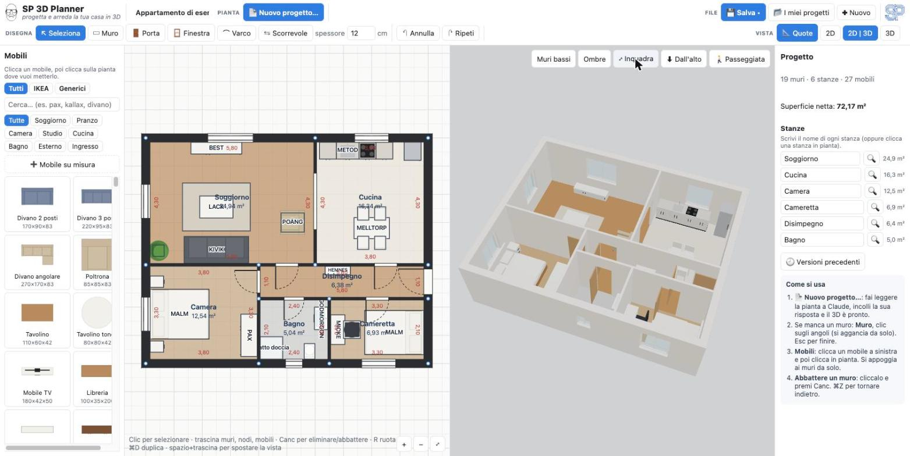
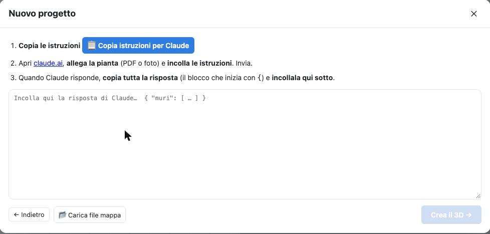
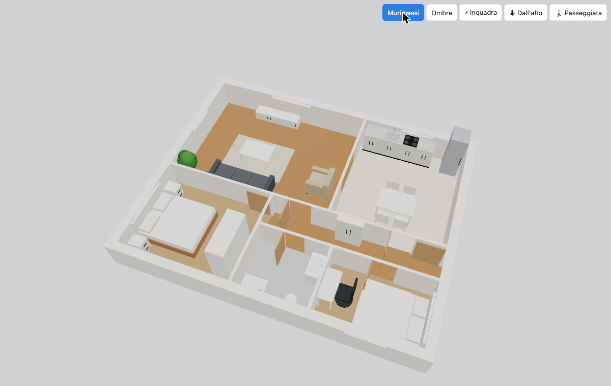

<p align="center"></p>

# SP 3D Planner

Progetta e arreda la tua casa in 3D partendo dalla pianta. Funziona tutto nel browser: niente da installare, niente account, i progetti restano sul tuo computer.

**Apri l'app:** https://procolo75.github.io/sp-3d-planner/



## Cosa fa

- **Dalla pianta al 3D**: fai leggere la pianta (PDF o foto, anche catastale e con le quote) a Claude, incolli la sua risposta e la casa è pronta in 2D e in 3D. Oppure la disegni a mano.
- **Muri**: disegni, sposti e **abbatti** i muri; le stanze si ricalcolano da sole con superficie e quote interne (da angolo ad angolo).
- **Porte, finestre, portefinestre, varchi e ante scorrevoli** (tipo SKYTTA, in vetro trasparente, satinato, bianco o specchio), con le distanze dai muri mentre le sposti.
- **Mobili**: catalogo di mobili generici e di oltre 150 articoli IKEA comuni con le misure di ingombro, piatti doccia e vasche in tutte le misure comuni, più il **mobile su misura** per qualsiasi altra cosa. Si appoggiano da soli ai muri e mostrano la distanza dalle pareti.
- **Arreda una stanza alla volta**: pianta e 3D mostrano solo quella stanza, da vicino.
- **3D**: vista d'insieme, dall'alto, muri bassi, ombre attivabili e **passeggiata** in prima persona con campo visivo regolabile.
- **Salvataggio**: «I miei progetti» nel browser, versioni precedenti automatiche, esportazione e importazione su file.

## Come si usa




Vuoi provare subito? In «Nuovo progetto» scegli «Carica file mappa» e apri [`docs/esempio-appartamento.json`](docs/esempio-appartamento.json).

1. **📄 Nuovo progetto…** → «Ho una pianta: la faccio leggere a Claude».
2. **Copia istruzioni per Claude**, apri [claude.ai](https://claude.ai), allega la pianta e incolla le istruzioni.
3. Copia la risposta di Claude (la mappa in JSON) nel riquadro e premi **Crea il 3D**.
4. Completa o correggi i muri con **Muro**, metti porte e finestre, poi scegli i mobili dal catalogo e cliccali in pianta.
5. **💾 Salva** (⌘S). Per spostare un progetto su un altro computer: **I miei progetti → ⬇ File**, poi **📥 Apri da file**.

I progetti sono salvati nel browser che usi: un altro browser o un altro computer non li vede finché non li importi da file.

### Arredare una stanza alla volta e distanze dai muri


### Vista 3D (muri bassi)



## Formato della mappa

La mappa che Claude restituisce (e che puoi scrivere anche a mano) è un JSON in centimetri, con l'origine in alto a sinistra e la y verso il basso:

```json
{
  "nome": "Casa",
  "altezza_muri": 280,
  "muri": [{ "da": [0, 0], "a": [1200, 0], "spessore": 30 }],
  "porte": [{ "pos": [400, 600], "larghezza": 80, "tipo": "porta" }],
  "finestre": [{ "pos": [200, 0], "larghezza": 120, "davanzale": 95, "altezza": 140 }],
  "stanze": [{ "nome": "Cucina", "pos": [900, 300] }]
}
```

I muri sono sulla linea centrale; `tipo` delle porte può essere `porta`, `portafinestra`, `varco` o `scorrevole`; un muro può avere `altezza` propria (es. parapetti). Dettagli in `src/import/mapJson.ts` e nelle istruzioni `src/import/claudePrompt.ts`.

## Sviluppo

```bash
npm install
npm run dev      # http://localhost:5173
npm test         # test (geometria, stanze, distanze, import della mappa)
npm run build    # versione pubblicabile in dist/
```

A ogni push su `main` il workflow `.github/workflows/deploy.yml` compila e pubblica su GitHub Pages.

### Struttura

- `src/model/` — modello dati (nodi, muri, aperture, mobili, stanze), operazioni sul grafo dei muri, undo, salvataggio
- `src/editor2d/` — pianta (SVG), agganci, distanze dai muri
- `src/three/` — scena 3D (react-three-fiber): muri con i fori, aperture, mobili, passeggiata
- `src/catalog/` — catalogo mobili parametrico (generici e IKEA)
- `src/import/` — import della mappa JSON, istruzioni per Claude, lettura PDF
- `src/ui/` — barra, pannelli, procedura «nuovo progetto», «I miei progetti»

## Note

I mobili sono forme semplificate con le misure di ingombro, non i modelli 3D originali; prima di comprare verifica le misure sul sito del produttore. IKEA e i nomi dei prodotti IKEA sono marchi di Inter IKEA Systems B.V.: questo progetto non è affiliato né approvato da IKEA.

## Licenza

[MIT](LICENSE) © 2026 Procolo Carannante
